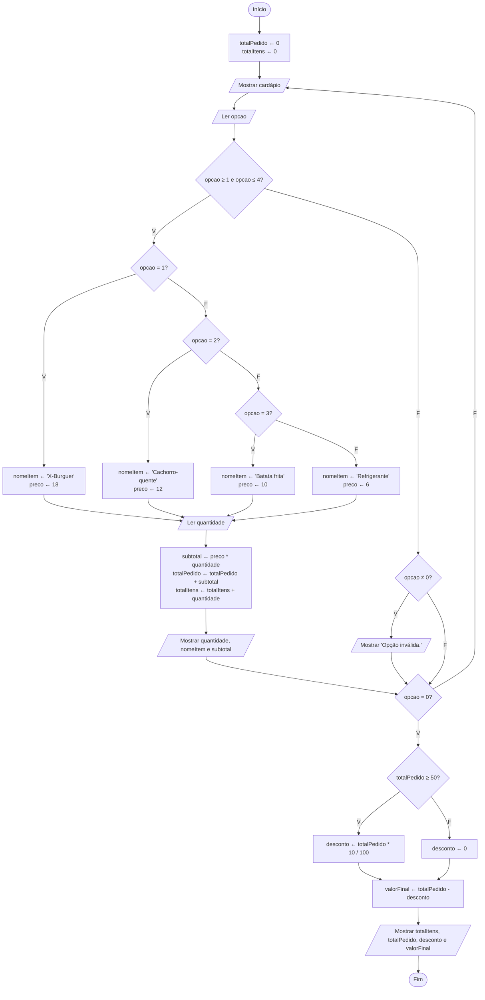

# Desafio Final — Sistema de pedidos de uma lanchonete

## 1. Descrição do problema

Uma lanchonete anota os pedidos no papel e soma os valores na calculadora, o que causa demora e erros no valor cobrado. A lanchonete precisa de um algoritmo que mostre o cardápio, registre os itens e as quantidades pedidas pelo cliente, calcule o valor do pedido e aplique um desconto de 10% para pedidos de R$ 50,00 ou mais.

Cardápio:

| Código | Item | Preço |
|---|---|---|
| 1 | X-Burguer | R$ 18,00 |
| 2 | Cachorro-quente | R$ 12,00 |
| 3 | Batata frita | R$ 10,00 |
| 4 | Refrigerante | R$ 6,00 |
| 0 | Finalizar pedido | — |

## 2. Entradas necessárias

- código do item escolhido (0 a 4);
- quantidade de cada item escolhido.

## 3. Processamento

- repetir a apresentação do cardápio até o código 0 (finalizar pedido);
- de acordo com o código, definir o nome e o preço do item;
- subtotal ← preco * quantidade;
- totalPedido ← totalPedido + subtotal;
- totalItens ← totalItens + quantidade;
- se o código não estiver entre 0 e 4, informar opção inválida;
- ao finalizar: se totalPedido ≥ 50, desconto ← totalPedido * 10 / 100; senão, desconto ← 0;
- valorFinal ← totalPedido - desconto.

## 4. Saídas esperadas

- cardápio;
- subtotal de cada item adicionado;
- mensagem de opção inválida, quando for o caso;
- quantidade total de itens, total do pedido, desconto e valor final a pagar.

## 5. Pseudocódigo completo

```
algoritmo "PedidosLanchonete"
var
   opcao, quantidade, totalItens: inteiro
   preco, subtotal, totalPedido, desconto, valorFinal: real
   nomeItem: caractere
inicio
   totalPedido <- 0
   totalItens <- 0
   repita
      escreval("========== CARDÁPIO ==========")
      escreval("1 - X-Burguer ........ R$ 18,00")
      escreval("2 - Cachorro-quente .. R$ 12,00")
      escreval("3 - Batata frita ..... R$ 10,00")
      escreval("4 - Refrigerante ..... R$ 6,00")
      escreval("0 - Finalizar pedido")
      escreva("Escolha uma opção: ")
      leia(opcao)
      se (opcao >= 1) e (opcao <= 4) entao
         se opcao = 1 entao
            nomeItem <- "X-Burguer"
            preco <- 18
         senao
            se opcao = 2 entao
               nomeItem <- "Cachorro-quente"
               preco <- 12
            senao
               se opcao = 3 entao
                  nomeItem <- "Batata frita"
                  preco <- 10
               senao
                  nomeItem <- "Refrigerante"
                  preco <- 6
               fimse
            fimse
         fimse
         escreva("Quantidade: ")
         leia(quantidade)
         subtotal <- preco * quantidade
         totalPedido <- totalPedido + subtotal
         totalItens <- totalItens + quantidade
         escreval(quantidade, " x ", nomeItem, " = R$ ", subtotal:0:2)
      senao
         se opcao <> 0 entao
            escreval("Opção inválida.")
         fimse
      fimse
   ate opcao = 0
   se totalPedido >= 50 entao
      desconto <- totalPedido * 10 / 100
   senao
      desconto <- 0
   fimse
   valorFinal <- totalPedido - desconto
   escreval("========== RESUMO DO PEDIDO ==========")
   escreval("Quantidade de itens: ", totalItens)
   escreval("Total do pedido: R$ ", totalPedido:0:2)
   escreval("Desconto: R$ ", desconto:0:2)
   escreval("Valor final a pagar: R$ ", valorFinal:0:2)
fimalgoritmo
```

## 6. Fluxograma



## 7. Teste de mesa

### Cenário 1 — Pedido abaixo de R$ 50,00 (sem desconto)

Entradas: opção 1 com quantidade 2; opção 4 com quantidade 2; opção 0.

| Passo | opcao | quantidade | nomeItem | preco | subtotal | totalPedido | totalItens | Saída |
|---|---|---|---|---|---|---|---|---|
| Início | — | — | — | — | — | 0 | 0 | — |
| 1 | 1 | 2 | X-Burguer | 18 | 36 | 36 | 2 | 2 x X-Burguer = R$ 36.00 |
| 2 | 4 | 2 | Refrigerante | 6 | 12 | 48 | 4 | 2 x Refrigerante = R$ 12.00 |
| 3 | 0 | — | — | — | — | 48 | 4 | encerra a repetição |
| Final | — | — | — | — | — | 48 | 4 | 48 ≥ 50? Falso → desconto = 0; valorFinal = 48 |

Resultado esperado: quantidade de itens 4; total R$ 48,00; desconto R$ 0,00; valor final R$ 48,00.

### Cenário 2 — Pedido acima de R$ 50,00 (com desconto)

Entradas: opção 1 com quantidade 2; opção 3 com quantidade 1; opção 4 com quantidade 2; opção 0.

| Passo | opcao | quantidade | nomeItem | preco | subtotal | totalPedido | totalItens | Saída |
|---|---|---|---|---|---|---|---|---|
| Início | — | — | — | — | — | 0 | 0 | — |
| 1 | 1 | 2 | X-Burguer | 18 | 36 | 36 | 2 | 2 x X-Burguer = R$ 36.00 |
| 2 | 3 | 1 | Batata frita | 10 | 10 | 46 | 3 | 1 x Batata frita = R$ 10.00 |
| 3 | 4 | 2 | Refrigerante | 6 | 12 | 58 | 5 | 2 x Refrigerante = R$ 12.00 |
| 4 | 0 | — | — | — | — | 58 | 5 | encerra a repetição |
| Final | — | — | — | — | — | 58 | 5 | 58 ≥ 50? Verdadeiro → desconto = 5,80; valorFinal = 52,20 |

Resultado esperado: quantidade de itens 5; total R$ 58,00; desconto R$ 5,80; valor final R$ 52,20.

### Cenário 3 — Opção inválida e pedido exatamente no limite de R$ 50,00

Entradas: opção 7; opção 3 com quantidade 5; opção 0.

| Passo | opcao | quantidade | nomeItem | preco | subtotal | totalPedido | totalItens | Saída |
|---|---|---|---|---|---|---|---|---|
| Início | — | — | — | — | — | 0 | 0 | — |
| 1 | 7 | — | — | — | — | 0 | 0 | Opção inválida. |
| 2 | 3 | 5 | Batata frita | 10 | 50 | 50 | 5 | 5 x Batata frita = R$ 50.00 |
| 3 | 0 | — | — | — | — | 50 | 5 | encerra a repetição |
| Final | — | — | — | — | — | 50 | 5 | 50 ≥ 50? Verdadeiro → desconto = 5,00; valorFinal = 45,00 |

Resultado esperado: mensagem "Opção inválida."; quantidade de itens 5; total R$ 50,00; desconto R$ 5,00; valor final R$ 45,00.

## 8. Explicação da solução desenvolvida

O algoritmo começa zerando os acumuladores `totalPedido` e `totalItens`. Em seguida, usa uma estrutura de repetição (`repita ... ate`) para mostrar o cardápio e ler a opção do cliente até que ele escolha 0 para finalizar o pedido.

Dentro da repetição, uma estrutura condicional verifica se a opção está entre 1 e 4. Se estiver, condicionais encadeadas definem o nome e o preço do item; depois o algoritmo lê a quantidade, calcula o subtotal e acumula os valores no total do pedido e na quantidade de itens. Se a opção não for válida, aparece a mensagem "Opção inválida." e o cardápio é mostrado de novo.

Quando o pedido é finalizado, o algoritmo verifica se o total chegou a R$ 50,00. Se chegou, aplica 10% de desconto; caso contrário, o desconto é zero. Por último, calcula o valor final e mostra o resumo do pedido.

A solução usa os conteúdos da disciplina: entrada e saída de dados, variáveis, operadores aritméticos e relacionais, estruturas condicionais, estrutura de repetição, contador e acumulador.
