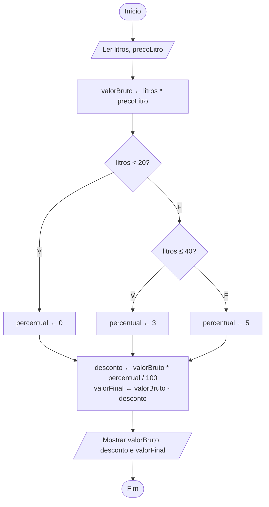

# Exercício 31 — Posto de combustível

**1. Entradas:** quantidade de litros abastecidos e preço do litro.

**2. Processamento:**
- valorBruto ← litros * precoLitro
- menos de 20 litros → percentual ← 0
- entre 20 e 40 litros → percentual ← 3
- mais de 40 litros → percentual ← 5
- desconto ← valorBruto * percentual / 100
- valorFinal ← valorBruto - desconto

**3. Saídas:** valor bruto, desconto e valor final.

**4. Pseudocódigo**

```
algoritmo "PostoCombustivel"
var
   litros, precoLitro, valorBruto, percentual, desconto, valorFinal: real
inicio
   escreva("Digite a quantidade de litros abastecidos: ")
   leia(litros)
   escreva("Digite o preço do litro: R$ ")
   leia(precoLitro)
   valorBruto <- litros * precoLitro
   se litros < 20 entao
      percentual <- 0
   senao
      se litros <= 40 entao
         percentual <- 3
      senao
         percentual <- 5
      fimse
   fimse
   desconto <- valorBruto * percentual / 100
   valorFinal <- valorBruto - desconto
   escreval("Valor bruto: R$ ", valorBruto:0:2)
   escreval("Desconto (", percentual:0:0, "%): R$ ", desconto:0:2)
   escreval("Valor final: R$ ", valorFinal:0:2)
fimalgoritmo
```

**5. Fluxograma**


