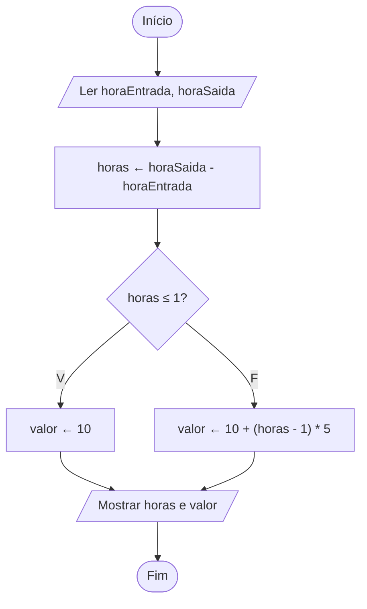

# Exercício 32 — Sistema de estacionamento

**1. Entradas:** hora de entrada e hora de saída (horas inteiras, de 0 a 23, no mesmo dia).

**2. Processamento:**
- horas ← horaSaida - horaEntrada
- se horas ≤ 1, valor ← 10
- senão, valor ← 10 + (horas - 1) * 5

**3. Saídas:** tempo de permanência (em horas) e valor total.

Observação: como o enunciado pede apenas a hora de entrada e a de saída, foram consideradas horas inteiras no mesmo dia, com a saída depois da entrada. Uma permanência menor que uma hora é cobrada como a primeira hora.

**4. Pseudocódigo**

```
algoritmo "Estacionamento"
var
   horaEntrada, horaSaida, horas: inteiro
   valor: real
inicio
   escreva("Digite a hora de entrada (0 a 23): ")
   leia(horaEntrada)
   escreva("Digite a hora de saída (0 a 23): ")
   leia(horaSaida)
   horas <- horaSaida - horaEntrada
   se horas <= 1 entao
      valor <- 10
   senao
      valor <- 10 + (horas - 1) * 5
   fimse
   escreval("Tempo de permanência: ", horas, " hora(s)")
   escreval("Valor total: R$ ", valor:0:2)
fimalgoritmo
```

**5. Fluxograma**


