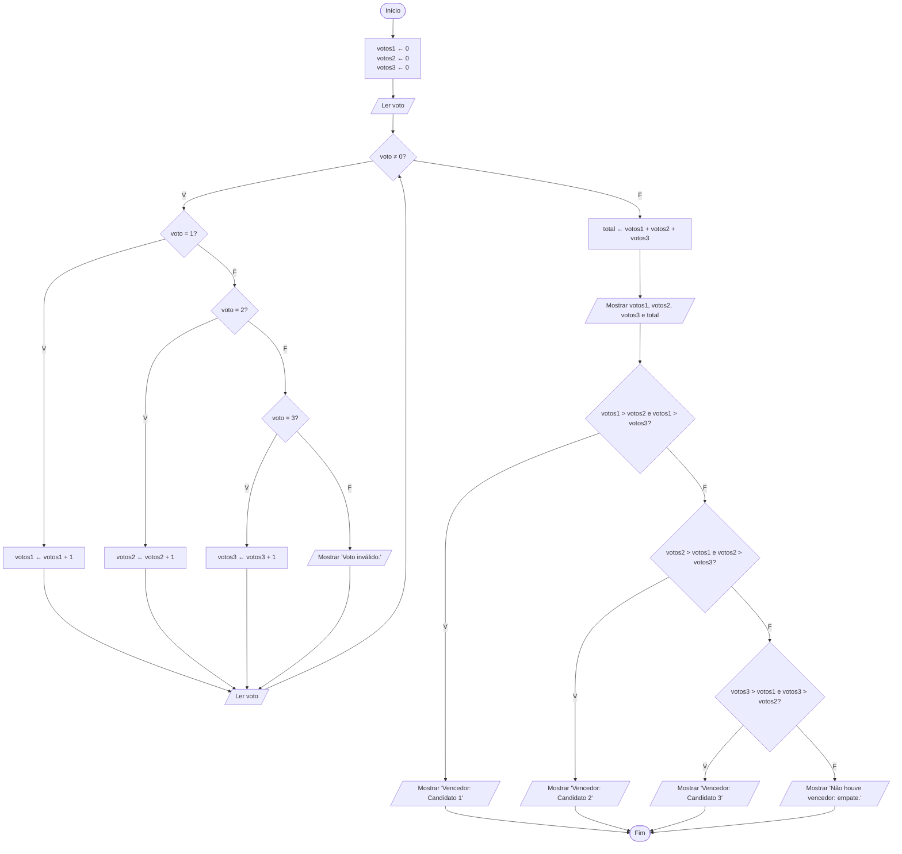

# Exercício 33 — Eleição

**1. Entradas:** votos (1, 2 ou 3); o valor 0 encerra a votação.

**2. Processamento:**
- enquanto o voto for diferente de 0: somar 1 ao contador do candidato escolhido; se o voto não for 1, 2 ou 3, informar voto inválido;
- total ← votos1 + votos2 + votos3;
- comparar os contadores para descobrir o vencedor (ou se houve empate).

**3. Saídas:** votos do candidato 1, votos do candidato 2, votos do candidato 3, total de votos e candidato vencedor.

Observação: votos diferentes de 0, 1, 2 e 3 não são contados. Se dois ou mais candidatos ficarem com o maior número de votos, o algoritmo informa empate.

**4. Pseudocódigo**

```
algoritmo "Eleicao"
var
   voto, votos1, votos2, votos3, total: inteiro
inicio
   votos1 <- 0
   votos2 <- 0
   votos3 <- 0
   escreva("Digite o voto (1, 2 ou 3) ou 0 para encerrar: ")
   leia(voto)
   enquanto voto <> 0 faca
      se voto = 1 entao
         votos1 <- votos1 + 1
      senao
         se voto = 2 entao
            votos2 <- votos2 + 1
         senao
            se voto = 3 entao
               votos3 <- votos3 + 1
            senao
               escreval("Voto inválido.")
            fimse
         fimse
      fimse
      escreva("Digite o voto (1, 2 ou 3) ou 0 para encerrar: ")
      leia(voto)
   fimenquanto
   total <- votos1 + votos2 + votos3
   escreval("Votos do candidato 1: ", votos1)
   escreval("Votos do candidato 2: ", votos2)
   escreval("Votos do candidato 3: ", votos3)
   escreval("Total de votos: ", total)
   se (votos1 > votos2) e (votos1 > votos3) entao
      escreval("Vencedor: Candidato 1")
   senao
      se (votos2 > votos1) e (votos2 > votos3) entao
         escreval("Vencedor: Candidato 2")
      senao
         se (votos3 > votos1) e (votos3 > votos2) entao
            escreval("Vencedor: Candidato 3")
         senao
            escreval("Não houve vencedor: empate.")
         fimse
      fimse
   fimse
fimalgoritmo
```

**5. Fluxograma**


