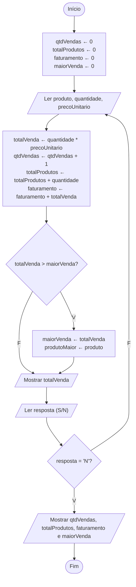

# Exercício 34 — Sistema de vendas

**1. Entradas:** para cada venda, nome do produto, quantidade e preço unitário; depois de cada venda, a resposta S ou N para registrar outra venda.

**2. Processamento:**
- totalVenda ← quantidade * precoUnitario
- qtdVendas ← qtdVendas + 1
- totalProdutos ← totalProdutos + quantidade
- faturamento ← faturamento + totalVenda
- se totalVenda > maiorVenda, guardar o valor e o produto dessa venda
- repetir até a resposta ser N

**3. Saídas:** total de cada venda e, ao final, quantidade de vendas realizadas, quantidade total de produtos vendidos, faturamento total e maior venda realizada.

**4. Pseudocódigo**

```
algoritmo "SistemaDeVendas"
var
   produto, produtoMaior, resposta: caractere
   quantidade, qtdVendas, totalProdutos: inteiro
   precoUnitario, totalVenda, faturamento, maiorVenda: real
inicio
   qtdVendas <- 0
   totalProdutos <- 0
   faturamento <- 0
   maiorVenda <- 0
   repita
      escreva("Nome do produto: ")
      leia(produto)
      escreva("Quantidade: ")
      leia(quantidade)
      escreva("Preço unitário: R$ ")
      leia(precoUnitario)
      totalVenda <- quantidade * precoUnitario
      qtdVendas <- qtdVendas + 1
      totalProdutos <- totalProdutos + quantidade
      faturamento <- faturamento + totalVenda
      se totalVenda > maiorVenda entao
         maiorVenda <- totalVenda
         produtoMaior <- produto
      fimse
      escreval("Total da venda: R$ ", totalVenda:0:2)
      escreva("Deseja registrar outra venda? (S/N): ")
      leia(resposta)
   ate (resposta = "N") ou (resposta = "n")
   escreval("Quantidade de vendas realizadas: ", qtdVendas)
   escreval("Quantidade total de produtos vendidos: ", totalProdutos)
   escreval("Faturamento total: R$ ", faturamento:0:2)
   escreval("Maior venda realizada: R$ ", maiorVenda:0:2, " (", produtoMaior, ")")
fimalgoritmo
```

**5. Fluxograma**


