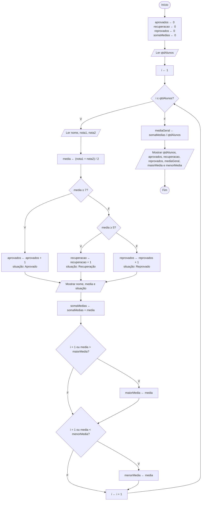

# Exercício 35 — Sistema acadêmico

**1. Entradas:** quantidade de alunos e, para cada aluno, nome, nota da primeira avaliação e nota da segunda avaliação.

**2. Processamento:**
- media ← (nota1 + nota2) / 2
- média ≥ 7 → Aprovado (aprovados ← aprovados + 1)
- média ≥ 5 e < 7 → Recuperação (recuperacao ← recuperacao + 1)
- média < 5 → Reprovado (reprovados ← reprovados + 1)
- somaMedias ← somaMedias + media
- guardar a maior e a menor média
- mediaGeral ← somaMedias / qtdAlunos

**3. Saídas:** média e situação de cada aluno e, ao final, quantidade de alunos, quantidade de aprovados, quantidade em recuperação, quantidade de reprovados, média geral da turma, maior média e menor média.

**4. Pseudocódigo**

```
algoritmo "SistemaAcademico"
var
   nome: caractere
   qtdAlunos, i, aprovados, recuperacao, reprovados: inteiro
   nota1, nota2, media, somaMedias, mediaGeral, maiorMedia, menorMedia: real
inicio
   aprovados <- 0
   recuperacao <- 0
   reprovados <- 0
   somaMedias <- 0
   escreva("Digite a quantidade de alunos: ")
   leia(qtdAlunos)
   para i de 1 ate qtdAlunos faca
      escreva("Nome do aluno ", i, ": ")
      leia(nome)
      escreva("Nota da primeira avaliação: ")
      leia(nota1)
      escreva("Nota da segunda avaliação: ")
      leia(nota2)
      media <- (nota1 + nota2) / 2
      se media >= 7 entao
         aprovados <- aprovados + 1
         escreval(nome, " - Média: ", media:0:2, " - Aprovado")
      senao
         se media >= 5 entao
            recuperacao <- recuperacao + 1
            escreval(nome, " - Média: ", media:0:2, " - Recuperação")
         senao
            reprovados <- reprovados + 1
            escreval(nome, " - Média: ", media:0:2, " - Reprovado")
         fimse
      fimse
      somaMedias <- somaMedias + media
      se (i = 1) ou (media > maiorMedia) entao
         maiorMedia <- media
      fimse
      se (i = 1) ou (media < menorMedia) entao
         menorMedia <- media
      fimse
   fimpara
   mediaGeral <- somaMedias / qtdAlunos
   escreval("Quantidade de alunos: ", qtdAlunos)
   escreval("Aprovados: ", aprovados)
   escreval("Em recuperação: ", recuperacao)
   escreval("Reprovados: ", reprovados)
   escreval("Média geral da turma: ", mediaGeral:0:2)
   escreval("Maior média: ", maiorMedia:0:2)
   escreval("Menor média: ", menorMedia:0:2)
fimalgoritmo
```

**5. Fluxograma**


