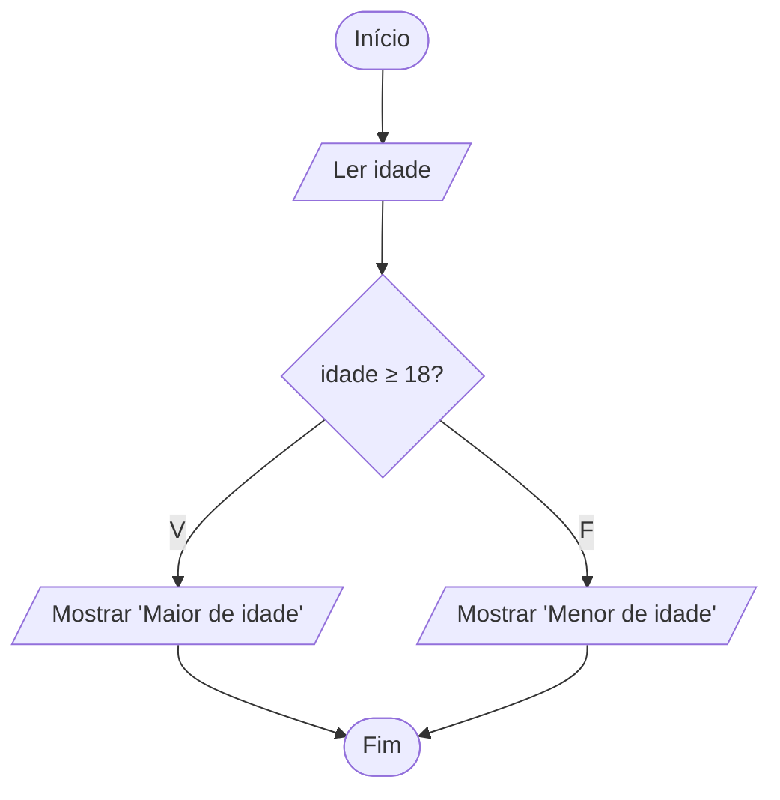

# Exercício 11 — Maior de idade

**1. Entradas:** idade da pessoa.

**2. Processamento:** verificar se idade ≥ 18.

**3. Saídas:** "Maior de idade" ou "Menor de idade".

**4. Pseudocódigo**

```
algoritmo "MaiorDeIdade"
var
   idade: inteiro
inicio
   escreva("Digite a idade: ")
   leia(idade)
   se idade >= 18 entao
      escreval("Maior de idade")
   senao
      escreval("Menor de idade")
   fimse
fimalgoritmo
```

**5. Fluxograma**


