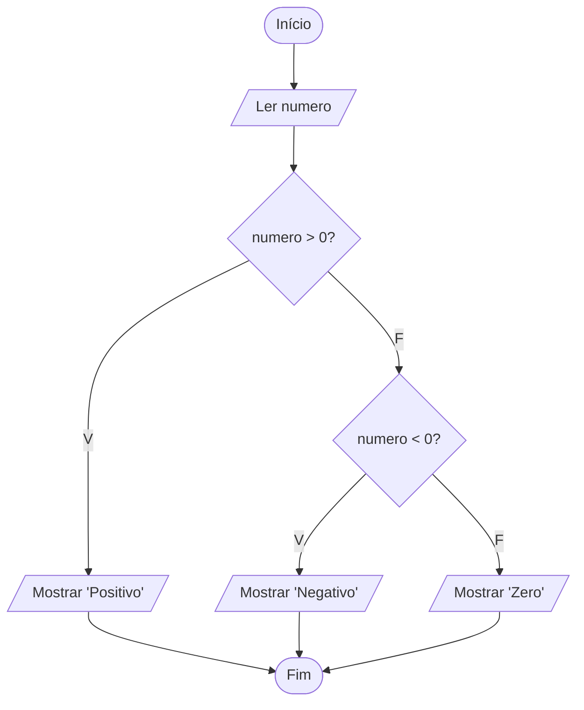

# Exercício 12 — Número positivo ou negativo

**1. Entradas:** um número.

**2. Processamento:** comparar o número com zero (maior, menor ou igual).

**3. Saídas:** "Positivo", "Negativo" ou "Zero".

**4. Pseudocódigo**

```
algoritmo "PositivoOuNegativo"
var
   numero: real
inicio
   escreva("Digite um número: ")
   leia(numero)
   se numero > 0 entao
      escreval("Positivo")
   senao
      se numero < 0 entao
         escreval("Negativo")
      senao
         escreval("Zero")
      fimse
   fimse
fimalgoritmo
```

**5. Fluxograma**


