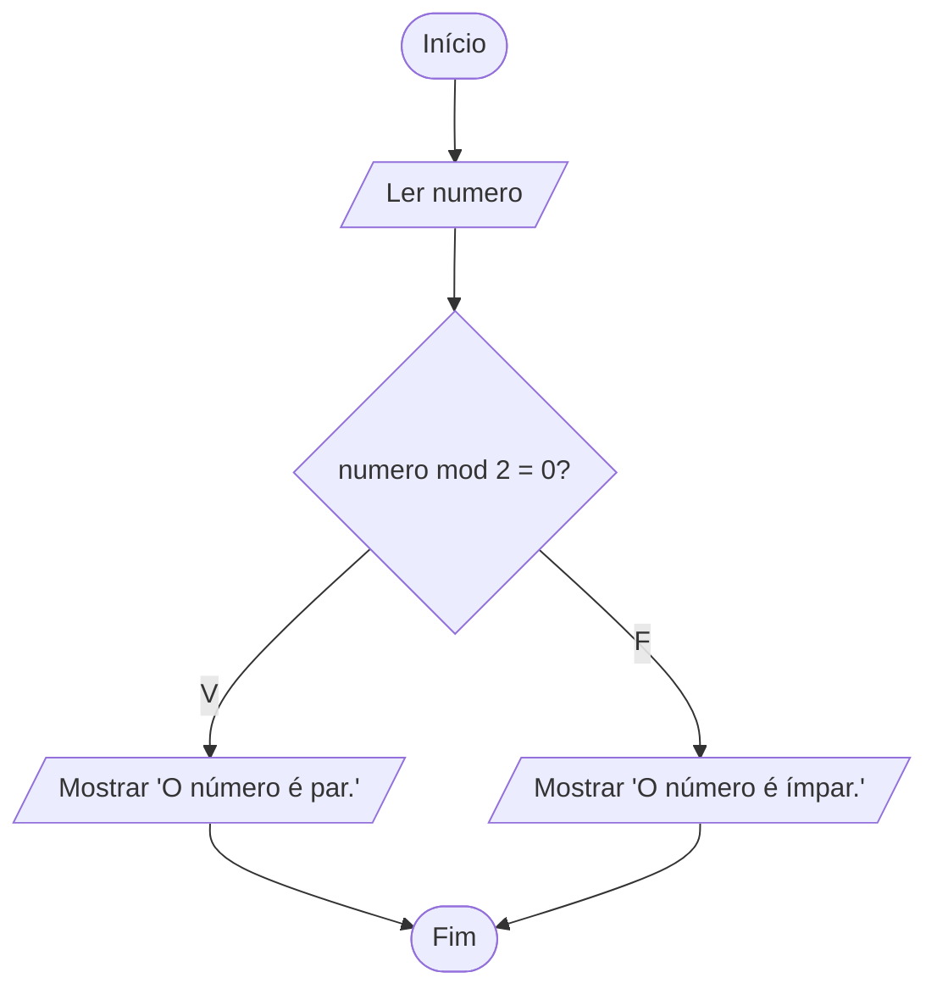

# Exercício 13 — Número par ou ímpar

**1. Entradas:** um número inteiro.

**2. Processamento:** calcular o resto da divisão por 2 (numero mod 2) e verificar se é igual a 0.

**3. Saídas:** "Par" ou "Ímpar".

**4. Pseudocódigo**

```
algoritmo "ParOuImpar"
var
   numero: inteiro
inicio
   escreva("Digite um número inteiro: ")
   leia(numero)
   se numero mod 2 = 0 entao
      escreval("O número é par.")
   senao
      escreval("O número é ímpar.")
   fimse
fimalgoritmo
```

**5. Fluxograma**


