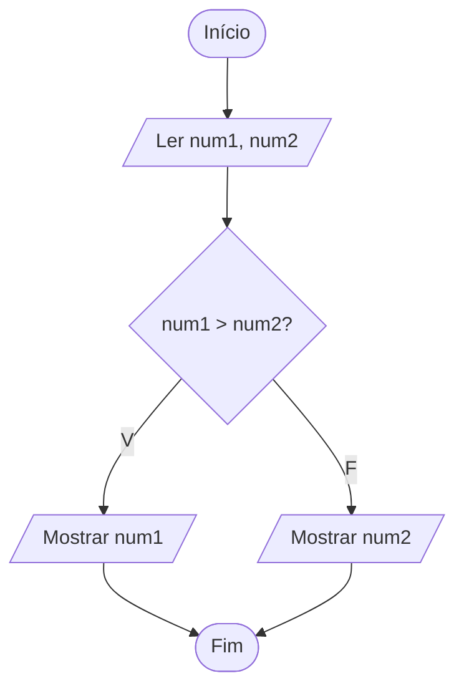

# Exercício 14 — Maior entre dois números

**1. Entradas:** dois números diferentes (num1 e num2).

**2. Processamento:** comparar num1 com num2.

**3. Saídas:** o maior número.

**4. Pseudocódigo**

```
algoritmo "MaiorEntreDois"
var
   num1, num2: real
inicio
   escreva("Digite o primeiro número: ")
   leia(num1)
   escreva("Digite o segundo número: ")
   leia(num2)
   se num1 > num2 entao
      escreval("O maior número é: ", num1)
   senao
      escreval("O maior número é: ", num2)
   fimse
fimalgoritmo
```

**5. Fluxograma**


