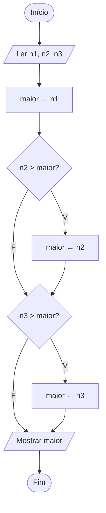

# Exercício 15 — Maior entre três números

**1. Entradas:** três números (n1, n2 e n3).

**2. Processamento:** considerar n1 como o maior; comparar com n2 e depois com n3, trocando o maior quando encontrar um valor maior.

**3. Saídas:** o maior número.

**4. Pseudocódigo**

```
algoritmo "MaiorEntreTres"
var
   n1, n2, n3, maior: real
inicio
   escreva("Digite o primeiro número: ")
   leia(n1)
   escreva("Digite o segundo número: ")
   leia(n2)
   escreva("Digite o terceiro número: ")
   leia(n3)
   maior <- n1
   se n2 > maior entao
      maior <- n2
   fimse
   se n3 > maior entao
      maior <- n3
   fimse
   escreval("O maior número é: ", maior)
fimalgoritmo
```

**5. Fluxograma**


