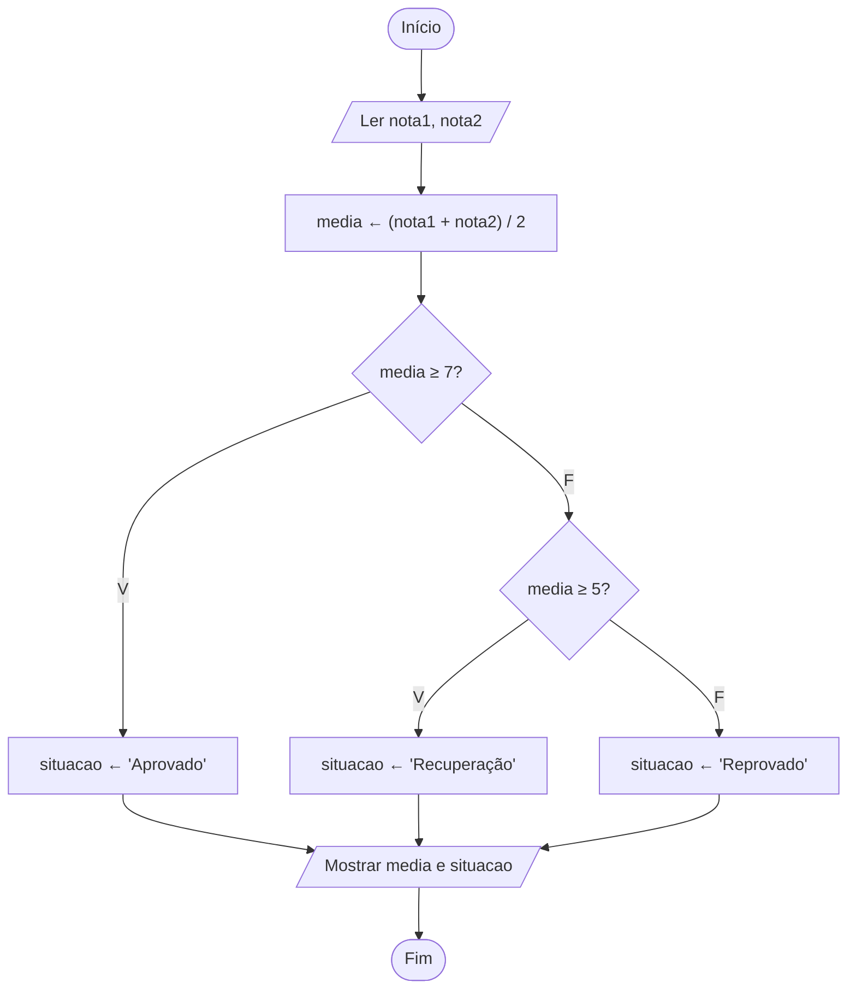

# Exercício 16 — Situação acadêmica

**1. Entradas:** duas notas (nota1 e nota2).

**2. Processamento:**
- media ← (nota1 + nota2) / 2
- média ≥ 7,0 → Aprovado
- média ≥ 5,0 e < 7,0 → Recuperação
- média < 5,0 → Reprovado

**3. Saídas:** média e situação do aluno.

**4. Pseudocódigo**

```
algoritmo "SituacaoAcademica"
var
   nota1, nota2, media: real
   situacao: caractere
inicio
   escreva("Digite a primeira nota: ")
   leia(nota1)
   escreva("Digite a segunda nota: ")
   leia(nota2)
   media <- (nota1 + nota2) / 2
   se media >= 7 entao
      situacao <- "Aprovado"
   senao
      se media >= 5 entao
         situacao <- "Recuperação"
      senao
         situacao <- "Reprovado"
      fimse
   fimse
   escreval("Média: ", media:0:2)
   escreval("Situação: ", situacao)
fimalgoritmo
```

**5. Fluxograma**


