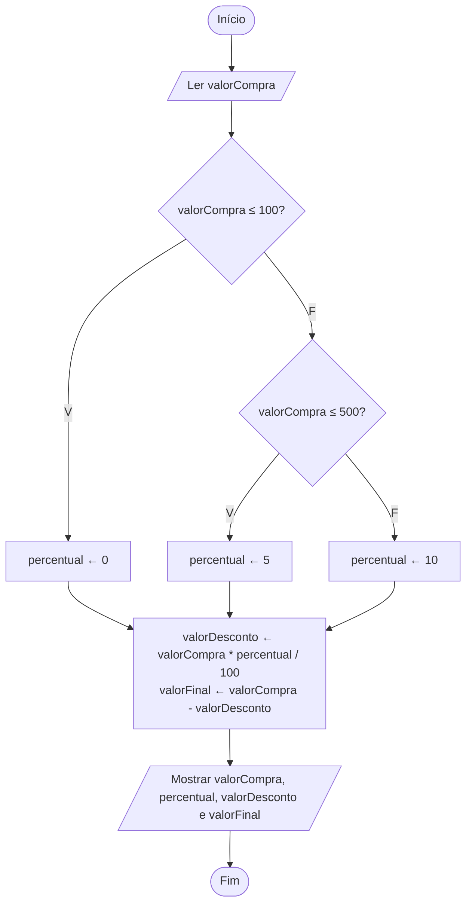

# Exercício 17 — Desconto na compra

**1. Entradas:** valor da compra.

**2. Processamento:**
- até R$ 100,00 → percentual ← 0
- de R$ 100,01 até R$ 500,00 → percentual ← 5
- acima de R$ 500,00 → percentual ← 10
- valorDesconto ← valorCompra * percentual / 100
- valorFinal ← valorCompra - valorDesconto

**3. Saídas:** valor original, percentual de desconto, valor do desconto e valor final.

**4. Pseudocódigo**

```
algoritmo "DescontoNaCompra"
var
   valorCompra, percentual, valorDesconto, valorFinal: real
inicio
   escreva("Digite o valor da compra: R$ ")
   leia(valorCompra)
   se valorCompra <= 100 entao
      percentual <- 0
   senao
      se valorCompra <= 500 entao
         percentual <- 5
      senao
         percentual <- 10
      fimse
   fimse
   valorDesconto <- valorCompra * percentual / 100
   valorFinal <- valorCompra - valorDesconto
   escreval("Valor original: R$ ", valorCompra:0:2)
   escreval("Percentual de desconto: ", percentual:0:0, "%")
   escreval("Valor do desconto: R$ ", valorDesconto:0:2)
   escreval("Valor final: R$ ", valorFinal:0:2)
fimalgoritmo
```

**5. Fluxograma**


