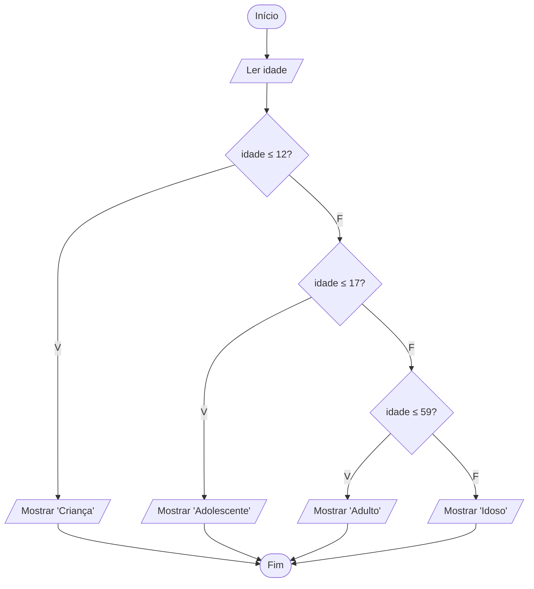

# Exercício 18 — Faixa etária

**1. Entradas:** idade da pessoa.

**2. Processamento:**
- 0 a 12 anos → Criança
- 13 a 17 anos → Adolescente
- 18 a 59 anos → Adulto
- 60 anos ou mais → Idoso

**3. Saídas:** classificação da faixa etária.

**4. Pseudocódigo**

```
algoritmo "FaixaEtaria"
var
   idade: inteiro
inicio
   escreva("Digite a idade: ")
   leia(idade)
   se idade <= 12 entao
      escreval("Criança")
   senao
      se idade <= 17 entao
         escreval("Adolescente")
      senao
         se idade <= 59 entao
            escreval("Adulto")
         senao
            escreval("Idoso")
         fimse
      fimse
   fimse
fimalgoritmo
```

**5. Fluxograma**


