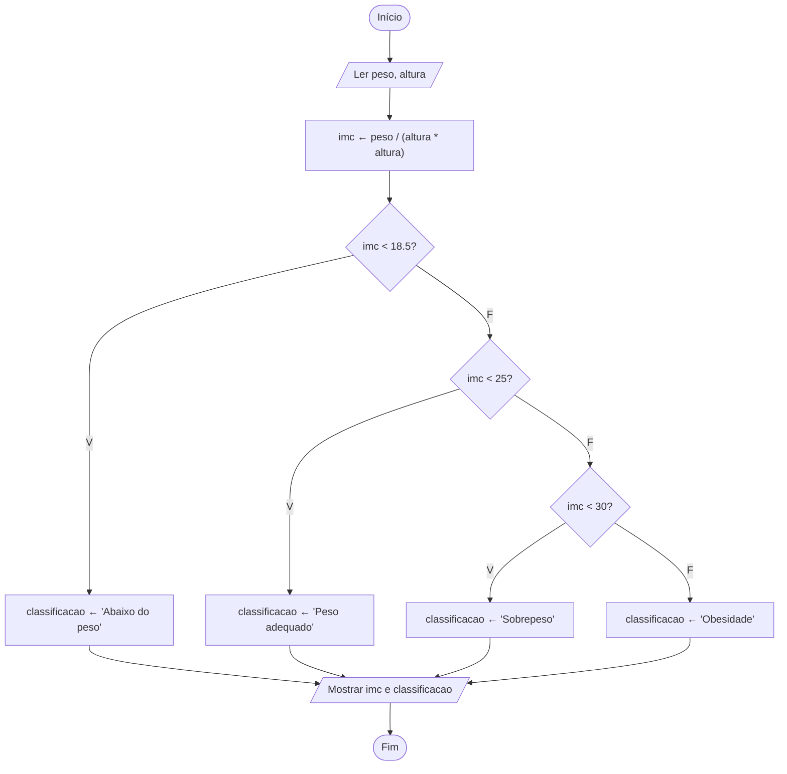

# Exercício 19 — Cálculo do IMC

**1. Entradas:** peso (kg) e altura (m).

**2. Processamento:**
- imc ← peso / (altura * altura)
- abaixo de 18,5 → Abaixo do peso
- de 18,5 até menos de 25 → Peso adequado
- de 25 até menos de 30 → Sobrepeso
- 30 ou mais → Obesidade

**3. Saídas:** valor do IMC e classificação.

Observação: as faixas foram comparadas com "menor que 25" e "menor que 30" para que valores como 24,95 também sejam classificados.

**4. Pseudocódigo**

```
algoritmo "CalculoIMC"
var
   peso, altura, imc: real
   classificacao: caractere
inicio
   escreva("Digite o peso (kg): ")
   leia(peso)
   escreva("Digite a altura (m): ")
   leia(altura)
   imc <- peso / (altura * altura)
   se imc < 18.5 entao
      classificacao <- "Abaixo do peso"
   senao
      se imc < 25 entao
         classificacao <- "Peso adequado"
      senao
         se imc < 30 entao
            classificacao <- "Sobrepeso"
         senao
            classificacao <- "Obesidade"
         fimse
      fimse
   fimse
   escreval("IMC: ", imc:0:1)
   escreval("Classificação: ", classificacao)
fimalgoritmo
```

**5. Fluxograma**


