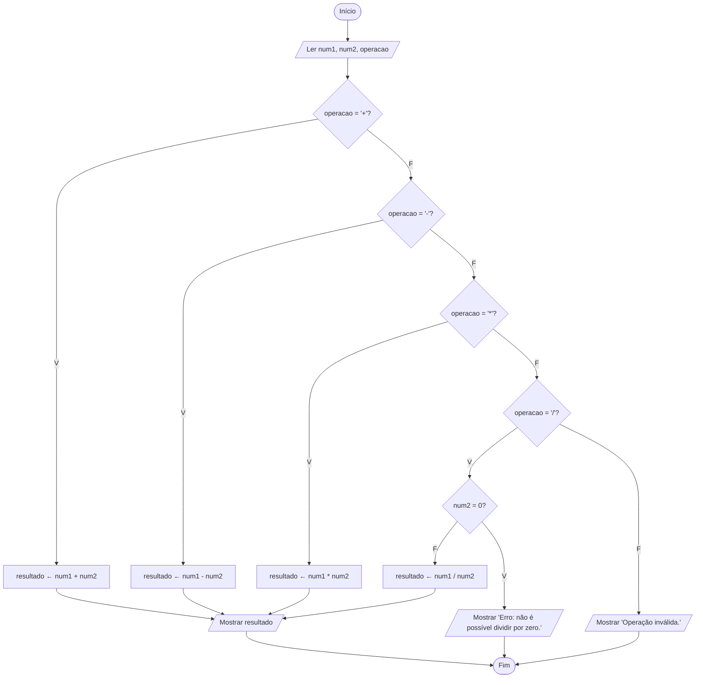

# Exercício 20 — Calculadora

**1. Entradas:** primeiro número, segundo número e operação desejada (+, -, * ou /).

**2. Processamento:**
- verificar qual operação foi escolhida e calcular o resultado;
- na divisão, verificar se o segundo número é zero antes de dividir;
- se a operação não for +, -, * ou /, informar operação inválida.

**3. Saídas:** resultado da operação, mensagem de erro de divisão por zero ou mensagem de operação inválida.

**4. Pseudocódigo**

```
algoritmo "Calculadora"
var
   num1, num2, resultado: real
   operacao: caractere
inicio
   escreva("Digite o primeiro número: ")
   leia(num1)
   escreva("Digite o segundo número: ")
   leia(num2)
   escreva("Digite a operação (+, -, * ou /): ")
   leia(operacao)
   se operacao = "+" entao
      resultado <- num1 + num2
      escreval("Resultado: ", resultado:0:2)
   senao
      se operacao = "-" entao
         resultado <- num1 - num2
         escreval("Resultado: ", resultado:0:2)
      senao
         se operacao = "*" entao
            resultado <- num1 * num2
            escreval("Resultado: ", resultado:0:2)
         senao
            se operacao = "/" entao
               se num2 = 0 entao
                  escreval("Erro: não é possível dividir por zero.")
               senao
                  resultado <- num1 / num2
                  escreval("Resultado: ", resultado:0:2)
               fimse
            senao
               escreval("Operação inválida.")
            fimse
         fimse
      fimse
   fimse
fimalgoritmo
```

**5. Fluxograma**


