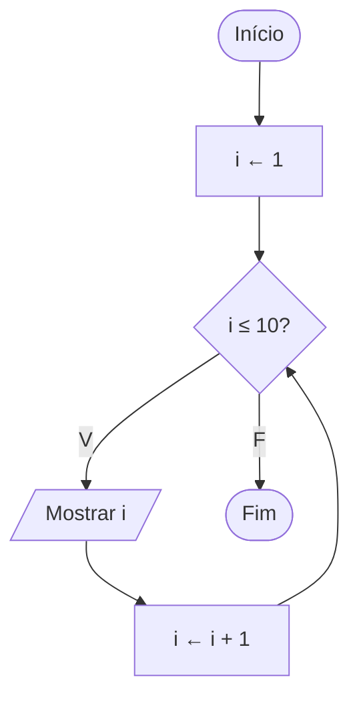

# Exercício 21 — Contagem crescente

**1. Entradas:** não há entradas do usuário.

**2. Processamento:** repetir com o contador i de 1 até 10.

**3. Saídas:** os números de 1 até 10.

**4. Pseudocódigo**

```
algoritmo "ContagemCrescente"
var
   i: inteiro
inicio
   para i de 1 ate 10 faca
      escreval(i)
   fimpara
fimalgoritmo
```

**5. Fluxograma**


