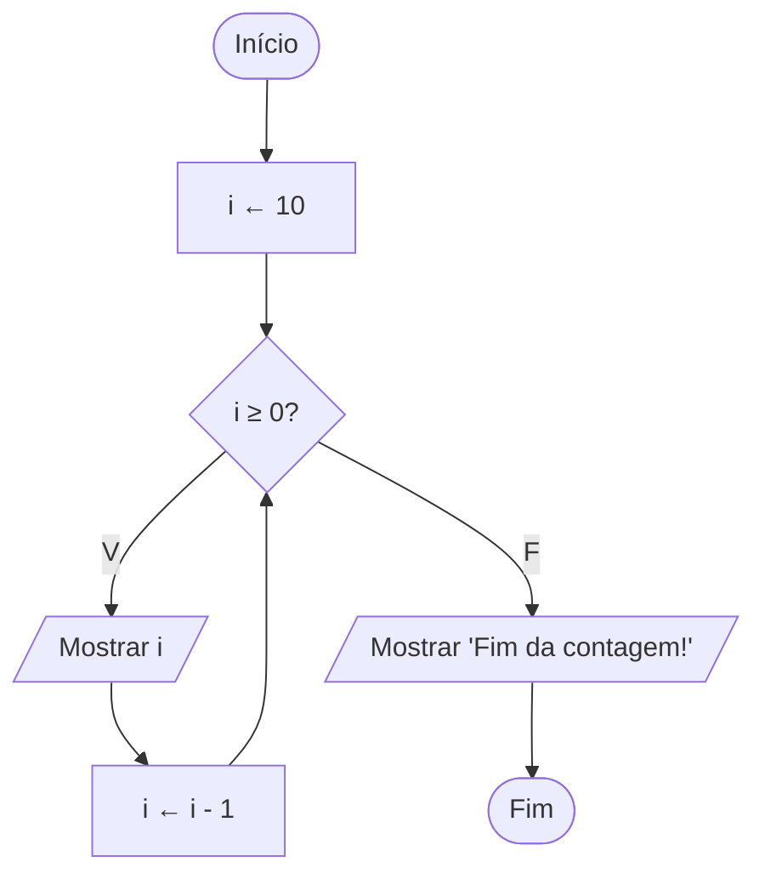

# Exercício 22 — Contagem regressiva

**1. Entradas:** não há entradas do usuário.

**2. Processamento:** repetir com o contador i de 10 até 0, diminuindo 1 a cada passo.

**3. Saídas:** os números de 10 até 0 e a mensagem "Fim da contagem!".

**4. Pseudocódigo**

```
algoritmo "ContagemRegressiva"
var
   i: inteiro
inicio
   para i de 10 ate 0 passo -1 faca
      escreval(i)
   fimpara
   escreval("Fim da contagem!")
fimalgoritmo
```

**5. Fluxograma**


