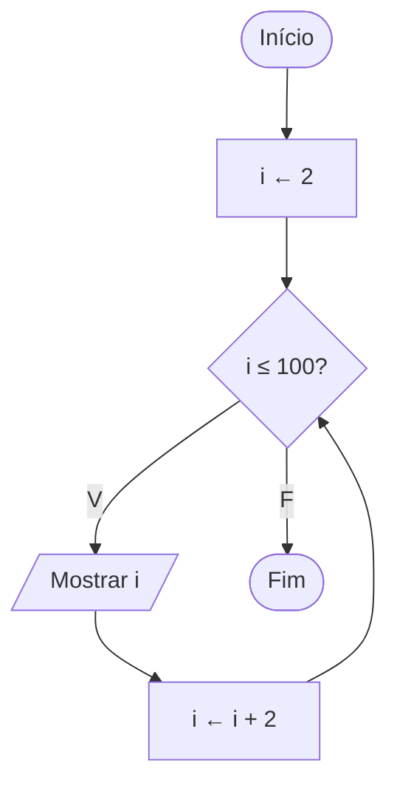

# Exercício 23 — Números pares

**1. Entradas:** não há entradas do usuário.

**2. Processamento:** repetir com o contador i começando em 2 e somando 2 a cada passo, até chegar a 100.

**3. Saídas:** todos os números pares de 2 até 100.

**4. Pseudocódigo**

```
algoritmo "NumerosPares"
var
   i: inteiro
inicio
   para i de 2 ate 100 passo 2 faca
      escreval(i)
   fimpara
fimalgoritmo
```

**5. Fluxograma**


