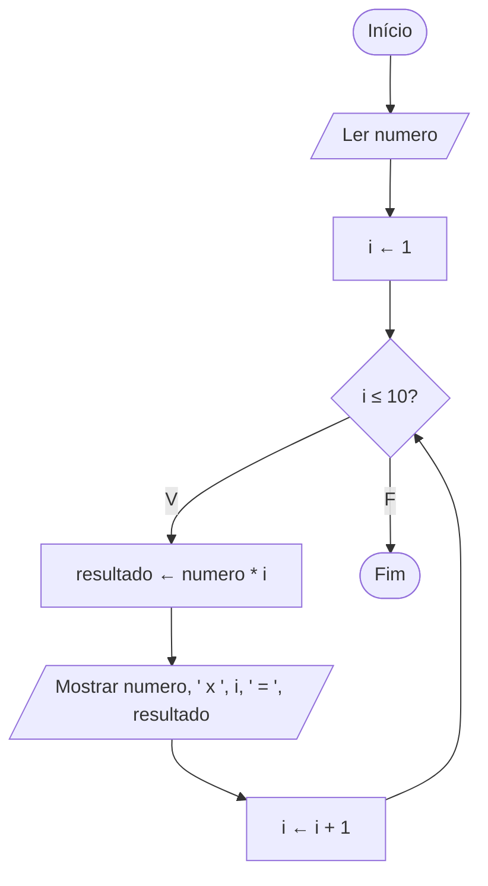

# Exercício 24 — Tabuada

**1. Entradas:** um número inteiro.

**2. Processamento:** repetir com i de 1 até 10, calculando resultado ← numero * i.

**3. Saídas:** a tabuada do número no formato "numero x i = resultado".

**4. Pseudocódigo**

```
algoritmo "Tabuada"
var
   numero, i, resultado: inteiro
inicio
   escreva("Digite um número inteiro: ")
   leia(numero)
   para i de 1 ate 10 faca
      resultado <- numero * i
      escreval(numero, " x ", i, " = ", resultado)
   fimpara
fimalgoritmo
```

**5. Fluxograma**


