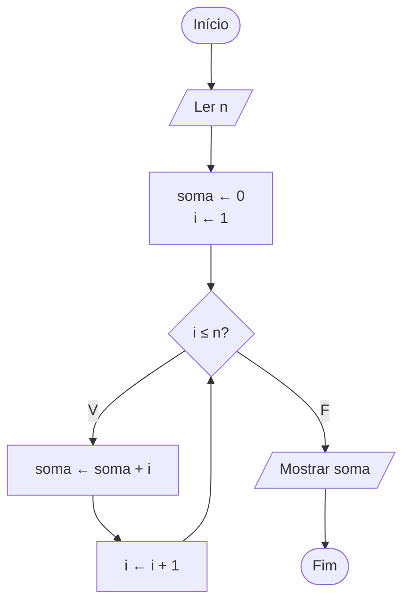

# Exercício 25 — Soma de 1 até N

**1. Entradas:** um número inteiro positivo N.

**2. Processamento:** soma ← 0; repetir com i de 1 até N, fazendo soma ← soma + i.

**3. Saídas:** a soma de 1 até N.

**4. Pseudocódigo**

```
algoritmo "SomaAteN"
var
   n, i, soma: inteiro
inicio
   escreva("Digite um número inteiro positivo: ")
   leia(n)
   soma <- 0
   para i de 1 ate n faca
      soma <- soma + i
   fimpara
   escreval("Soma de 1 até ", n, ": ", soma)
fimalgoritmo
```

**5. Fluxograma**


