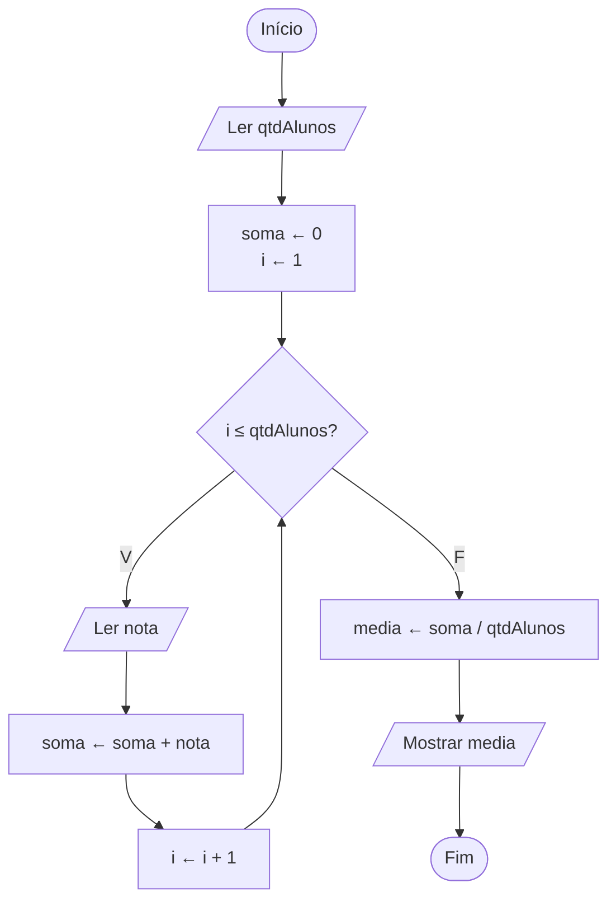

# Exercício 26 — Média da turma

**1. Entradas:** quantidade de alunos e a nota de cada aluno.

**2. Processamento:**
- soma ← 0
- repetir para cada aluno: ler a nota e fazer soma ← soma + nota
- media ← soma / qtdAlunos

**3. Saídas:** média geral da turma.

**4. Pseudocódigo**

```
algoritmo "MediaDaTurma"
var
   qtdAlunos, i: inteiro
   nota, soma, media: real
inicio
   escreva("Digite a quantidade de alunos: ")
   leia(qtdAlunos)
   soma <- 0
   para i de 1 ate qtdAlunos faca
      escreva("Digite a nota do aluno ", i, ": ")
      leia(nota)
      soma <- soma + nota
   fimpara
   media <- soma / qtdAlunos
   escreval("Média geral da turma: ", media:0:2)
fimalgoritmo
```

**5. Fluxograma**


