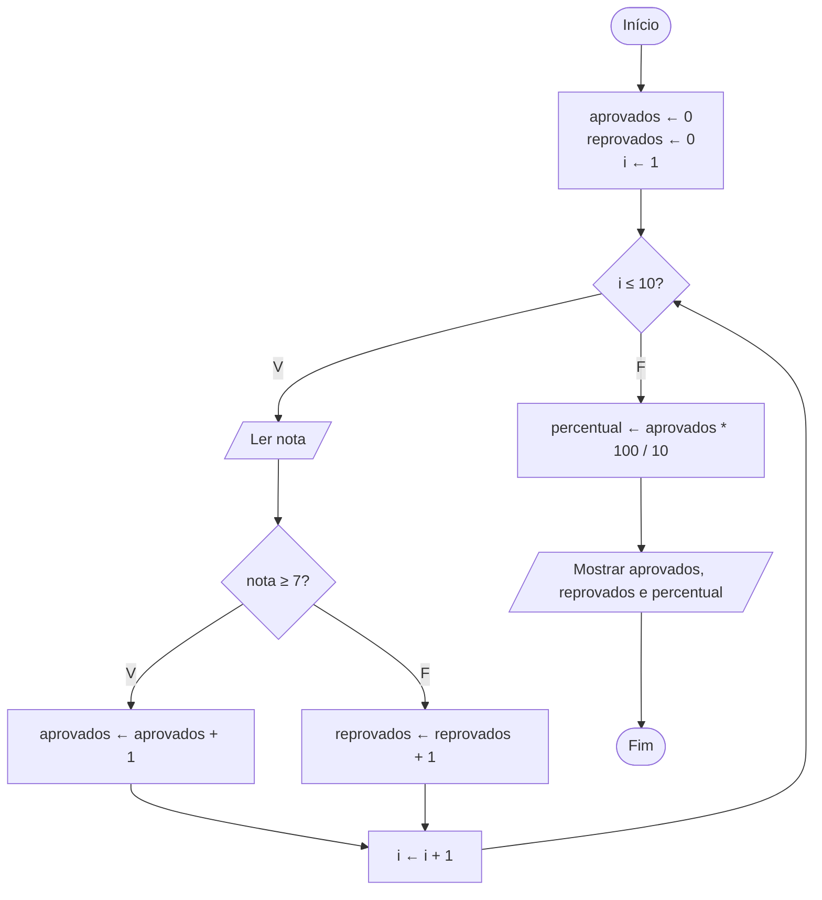

# Exercício 27 — Aprovados e reprovados

**1. Entradas:** as notas de 10 alunos.

**2. Processamento:**
- para cada nota: se nota ≥ 7, aprovados ← aprovados + 1; senão, reprovados ← reprovados + 1
- percentual ← aprovados * 100 / 10

**3. Saídas:** quantidade de aprovados, quantidade de reprovados e percentual de aprovação.

**4. Pseudocódigo**

```
algoritmo "AprovadosReprovados"
var
   i, aprovados, reprovados: inteiro
   nota, percentual: real
inicio
   aprovados <- 0
   reprovados <- 0
   para i de 1 ate 10 faca
      escreva("Digite a nota do aluno ", i, ": ")
      leia(nota)
      se nota >= 7 entao
         aprovados <- aprovados + 1
      senao
         reprovados <- reprovados + 1
      fimse
   fimpara
   percentual <- aprovados * 100 / 10
   escreval("Quantidade de aprovados: ", aprovados)
   escreval("Quantidade de reprovados: ", reprovados)
   escreval("Percentual de aprovação: ", percentual:0:1, "%")
fimalgoritmo
```

**5. Fluxograma**


