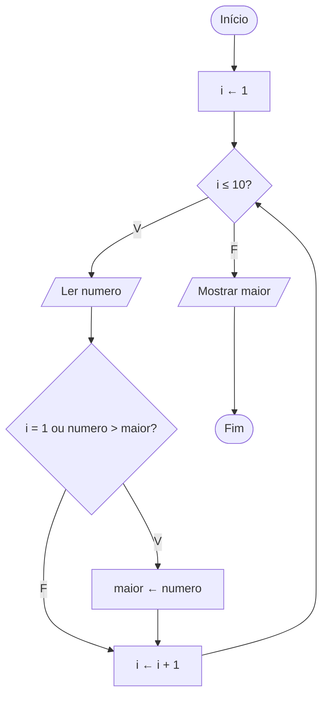

# Exercício 28 — Maior número

**1. Entradas:** 10 números.

**2. Processamento:** o primeiro número lido passa a ser o maior; a cada novo número, se ele for maior que o maior atual, ele passa a ser o maior.

**3. Saídas:** o maior número informado.

**4. Pseudocódigo**

```
algoritmo "MaiorNumero"
var
   i: inteiro
   numero, maior: real
inicio
   para i de 1 ate 10 faca
      escreva("Digite o ", i, "º número: ")
      leia(numero)
      se (i = 1) ou (numero > maior) entao
         maior <- numero
      fimse
   fimpara
   escreval("O maior número informado foi: ", maior)
fimalgoritmo
```

**5. Fluxograma**


