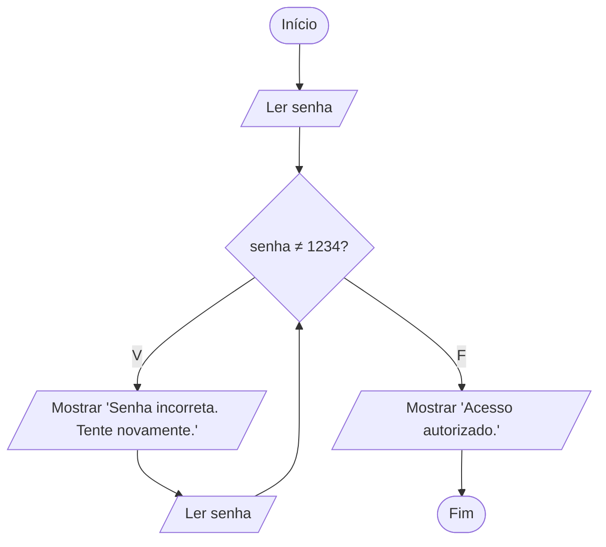

# Exercício 29 — Senha

**1. Entradas:** senha digitada pelo usuário (quantas vezes forem necessárias).

**2. Processamento:** enquanto a senha for diferente de 1234, mostrar a mensagem de erro e ler a senha novamente.

**3. Saídas:** "Senha incorreta. Tente novamente." a cada erro e "Acesso autorizado." quando a senha estiver correta.

**4. Pseudocódigo**

```
algoritmo "Senha"
var
   senha: inteiro
inicio
   escreva("Digite a senha: ")
   leia(senha)
   enquanto senha <> 1234 faca
      escreval("Senha incorreta. Tente novamente.")
      escreva("Digite a senha: ")
      leia(senha)
   fimenquanto
   escreval("Acesso autorizado.")
fimalgoritmo
```

**5. Fluxograma**


