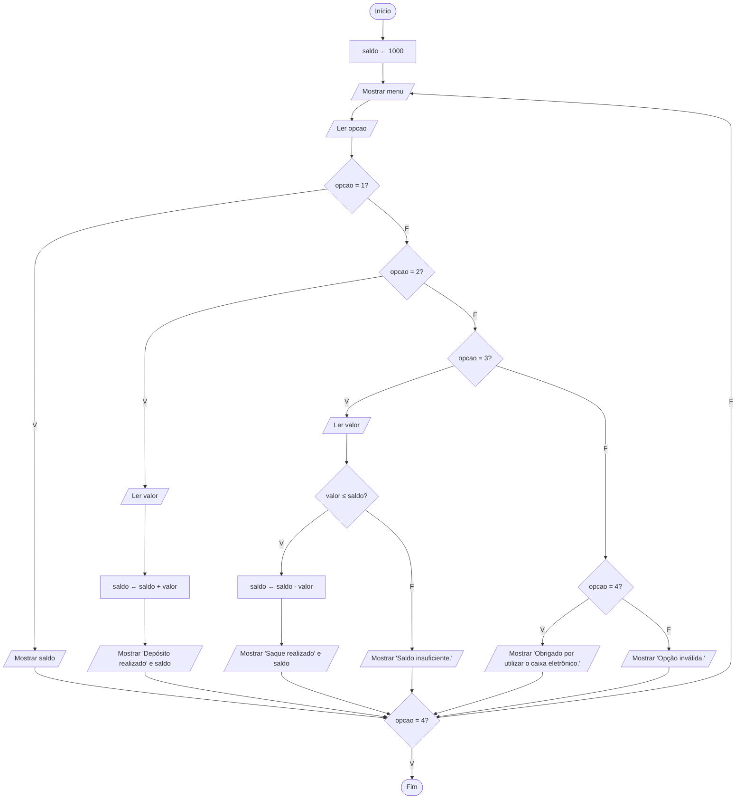

# Exercício 30 — Caixa eletrônico

**1. Entradas:** opção do menu e, quando necessário, o valor do depósito ou do saque.

**2. Processamento:**
- o saldo inicial é definido pelo programa: saldo ← 1000;
- mostrar o menu e ler a opção, repetindo até a opção 4 (Sair);
- opção 1: mostrar o saldo;
- opção 2: saldo ← saldo + valor;
- opção 3: se valor ≤ saldo, saldo ← saldo - valor; senão, informar saldo insuficiente;
- outra opção: informar opção inválida.

**3. Saídas:** menu, saldo atual, confirmações de depósito e saque, mensagem de saldo insuficiente, mensagem de opção inválida e mensagem de encerramento.

**4. Pseudocódigo**

```
algoritmo "CaixaEletronico"
var
   opcao: inteiro
   saldo, valor: real
inicio
   saldo <- 1000
   repita
      escreval("===== CAIXA ELETRÔNICO =====")
      escreval("1 - Consultar saldo")
      escreval("2 - Depositar")
      escreval("3 - Sacar")
      escreval("4 - Sair")
      escreva("Escolha uma opção: ")
      leia(opcao)
      se opcao = 1 entao
         escreval("Saldo atual: R$ ", saldo:0:2)
      senao
         se opcao = 2 entao
            escreva("Digite o valor do depósito: R$ ")
            leia(valor)
            saldo <- saldo + valor
            escreval("Depósito realizado. Saldo atual: R$ ", saldo:0:2)
         senao
            se opcao = 3 entao
               escreva("Digite o valor do saque: R$ ")
               leia(valor)
               se valor <= saldo entao
                  saldo <- saldo - valor
                  escreval("Saque realizado. Saldo atual: R$ ", saldo:0:2)
               senao
                  escreval("Saldo insuficiente.")
               fimse
            senao
               se opcao = 4 entao
                  escreval("Obrigado por utilizar o caixa eletrônico.")
               senao
                  escreval("Opção inválida.")
               fimse
            fimse
         fimse
      fimse
   ate opcao = 4
fimalgoritmo
```

**5. Fluxograma**



Observação: o enunciado diz que o saldo inicial é "informado pelo programa"; por isso, o próprio algoritmo define o saldo inicial de R$ 1.000,00.
