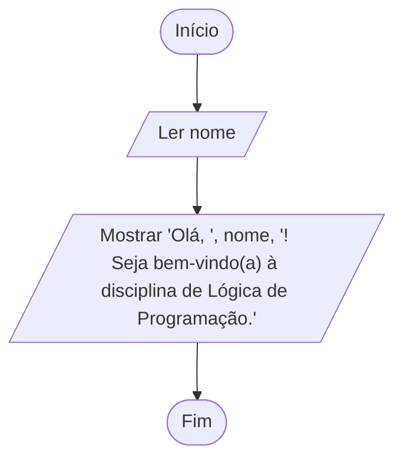

# Exercício 01 — Saudação

**1. Entradas:** nome da pessoa.

**2. Processamento:** montar a mensagem de boas-vindas com o nome informado.

**3. Saídas:** mensagem "Olá, [nome]! Seja bem-vindo(a) à disciplina de Lógica de Programação."

**4. Pseudocódigo**

```
algoritmo "Saudacao"
var
   nome: caractere
inicio
   escreva("Digite seu nome: ")
   leia(nome)
   escreval("Olá, ", nome, "! Seja bem-vindo(a) à disciplina de Lógica de Programação.")
fimalgoritmo
```

**5. Fluxograma**


