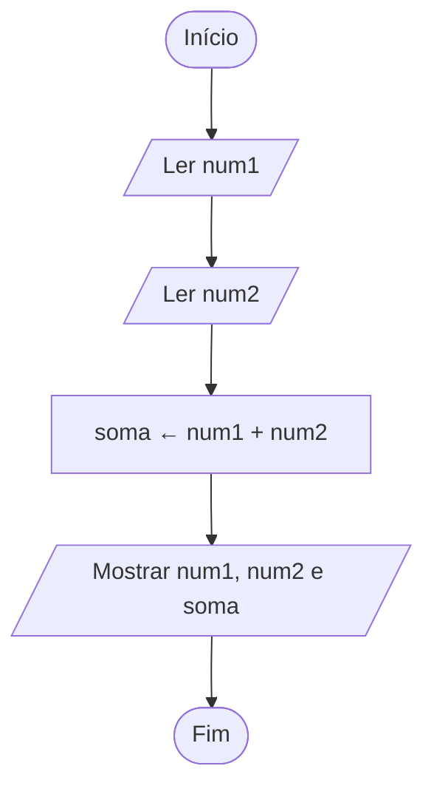

# Exercício 02 — Soma de dois números

**1. Entradas:** dois números inteiros (num1 e num2).

**2. Processamento:** soma ← num1 + num2.

**3. Saídas:** o primeiro número, o segundo número e a soma.

**4. Pseudocódigo**

```
algoritmo "SomaDoisNumeros"
var
   num1, num2, soma: inteiro
inicio
   escreva("Digite o primeiro número: ")
   leia(num1)
   escreva("Digite o segundo número: ")
   leia(num2)
   soma <- num1 + num2
   escreval("Primeiro número: ", num1)
   escreval("Segundo número: ", num2)
   escreval("Soma: ", soma)
fimalgoritmo
```

**5. Fluxograma**


