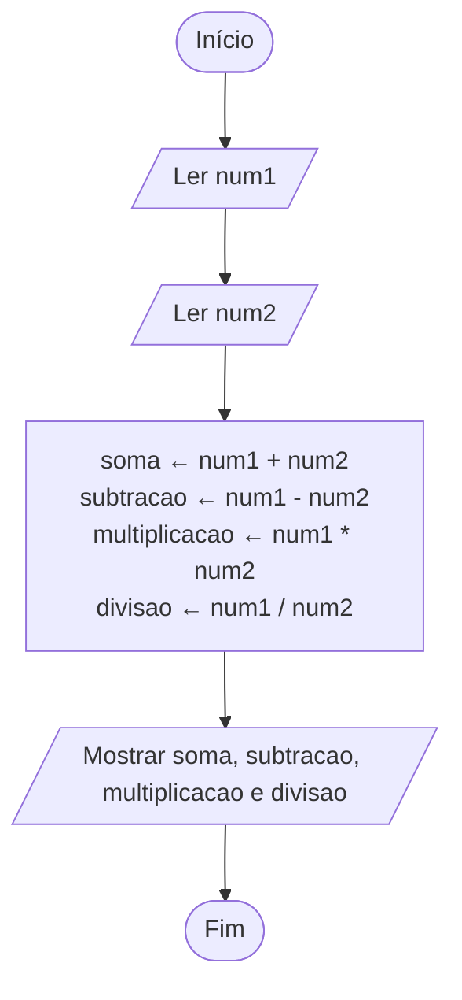

# Exercício 03 — Quatro operações

**1. Entradas:** dois números (num1 e num2).

**2. Processamento:**
- soma ← num1 + num2
- subtracao ← num1 - num2
- multiplicacao ← num1 * num2
- divisao ← num1 / num2

**3. Saídas:** soma, subtração, multiplicação e divisão.

**4. Pseudocódigo**

```
algoritmo "QuatroOperacoes"
var
   num1, num2, soma, subtracao, multiplicacao, divisao: real
inicio
   escreva("Digite o primeiro número: ")
   leia(num1)
   escreva("Digite o segundo número: ")
   leia(num2)
   soma <- num1 + num2
   subtracao <- num1 - num2
   multiplicacao <- num1 * num2
   divisao <- num1 / num2
   escreval("Soma: ", soma:0:2)
   escreval("Subtração: ", subtracao:0:2)
   escreval("Multiplicação: ", multiplicacao:0:2)
   escreval("Divisão: ", divisao:0:2)
fimalgoritmo
```

**5. Fluxograma**


