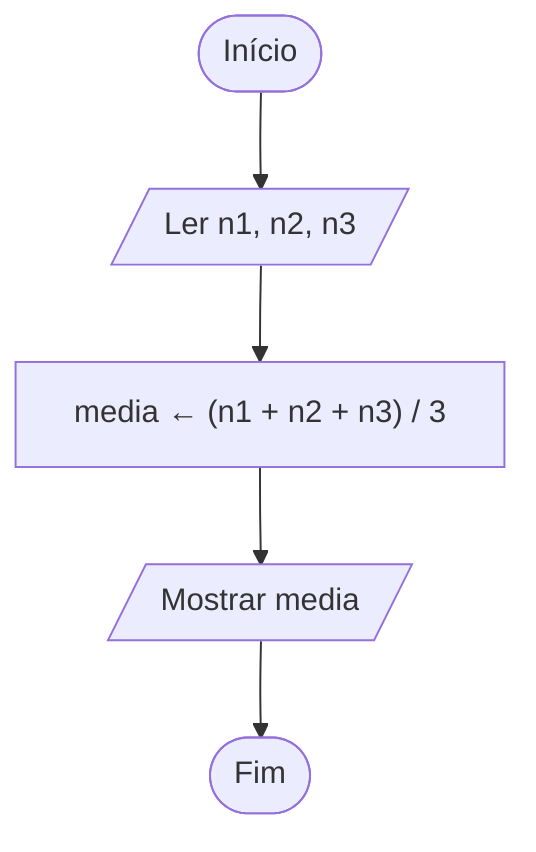

# Exercício 04 — Média do aluno

**1. Entradas:** três notas (n1, n2 e n3).

**2. Processamento:** media ← (n1 + n2 + n3) / 3.

**3. Saídas:** média final.

**4. Pseudocódigo**

```
algoritmo "MediaDoAluno"
var
   n1, n2, n3, media: real
inicio
   escreva("Digite a primeira nota: ")
   leia(n1)
   escreva("Digite a segunda nota: ")
   leia(n2)
   escreva("Digite a terceira nota: ")
   leia(n3)
   media <- (n1 + n2 + n3) / 3
   escreval("Média final: ", media:0:2)
fimalgoritmo
```

**5. Fluxograma**


