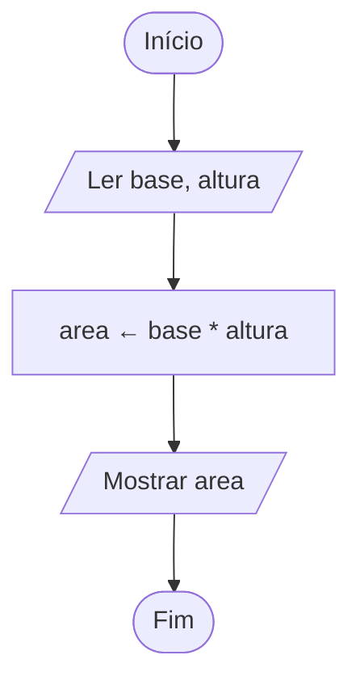

# Exercício 05 — Área do retângulo

**1. Entradas:** base e altura do retângulo.

**2. Processamento:** area ← base * altura.

**3. Saídas:** área do retângulo.

**4. Pseudocódigo**

```
algoritmo "AreaRetangulo"
var
   base, altura, area: real
inicio
   escreva("Digite a base: ")
   leia(base)
   escreva("Digite a altura: ")
   leia(altura)
   area <- base * altura
   escreval("Área do retângulo: ", area:0:2)
fimalgoritmo
```

**5. Fluxograma**


