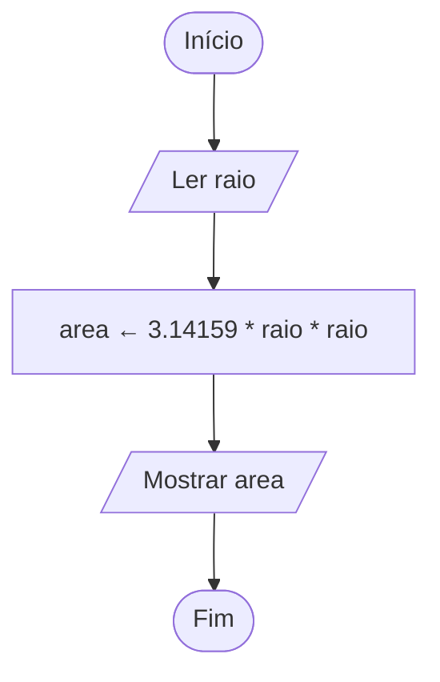

# Exercício 06 — Área do círculo

**1. Entradas:** raio do círculo.

**2. Processamento:** area ← 3.14159 * raio * raio (π × raio²).

**3. Saídas:** área do círculo.

**4. Pseudocódigo**

```
algoritmo "AreaCirculo"
var
   raio, area: real
inicio
   escreva("Digite o raio: ")
   leia(raio)
   area <- 3.14159 * raio * raio
   escreval("Área do círculo: ", area:0:2)
fimalgoritmo
```

**5. Fluxograma**


