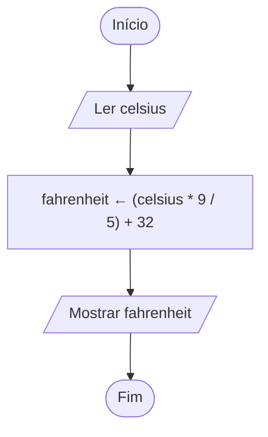

# Exercício 07 — Conversão de temperatura

**1. Entradas:** temperatura em graus Celsius.

**2. Processamento:** fahrenheit ← (celsius * 9 / 5) + 32.

**3. Saídas:** temperatura em graus Fahrenheit.

**4. Pseudocódigo**

```
algoritmo "ConversaoTemperatura"
var
   celsius, fahrenheit: real
inicio
   escreva("Digite a temperatura em Celsius: ")
   leia(celsius)
   fahrenheit <- (celsius * 9 / 5) + 32
   escreval("Temperatura em Fahrenheit: ", fahrenheit:0:2)
fimalgoritmo
```

**5. Fluxograma**


