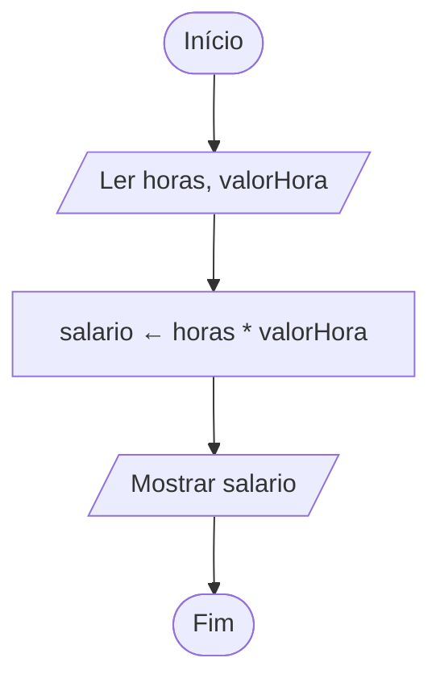

# Exercício 08 — Salário mensal

**1. Entradas:** quantidade de horas trabalhadas e valor recebido por hora.

**2. Processamento:** salario ← horas * valorHora.

**3. Saídas:** salário bruto do funcionário.

**4. Pseudocódigo**

```
algoritmo "SalarioMensal"
var
   horas, valorHora, salario: real
inicio
   escreva("Digite a quantidade de horas trabalhadas: ")
   leia(horas)
   escreva("Digite o valor recebido por hora: ")
   leia(valorHora)
   salario <- horas * valorHora
   escreval("Salário bruto: R$ ", salario:0:2)
fimalgoritmo
```

**5. Fluxograma**


