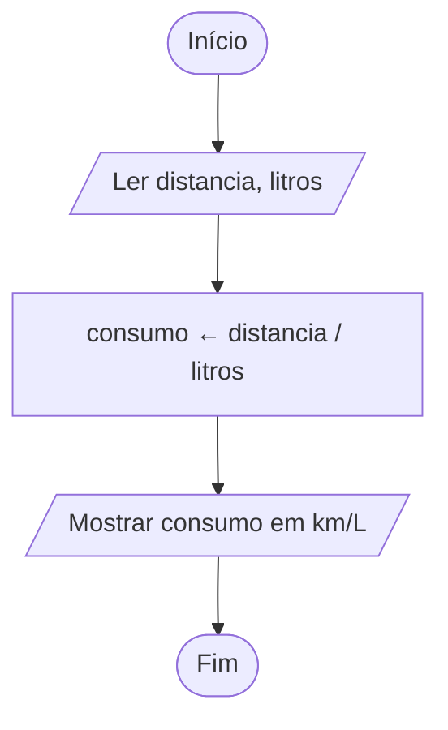

# Exercício 09 — Consumo de combustível

**1. Entradas:** distância percorrida (km) e quantidade de combustível utilizada (litros).

**2. Processamento:** consumo ← distancia / litros.

**3. Saídas:** consumo médio do veículo em km/L.

**4. Pseudocódigo**

```
algoritmo "ConsumoCombustivel"
var
   distancia, litros, consumo: real
inicio
   escreva("Digite a distância percorrida (km): ")
   leia(distancia)
   escreva("Digite a quantidade de combustível (litros): ")
   leia(litros)
   consumo <- distancia / litros
   escreval("Consumo médio: ", consumo:0:2, " km/L")
fimalgoritmo
```

**5. Fluxograma**


