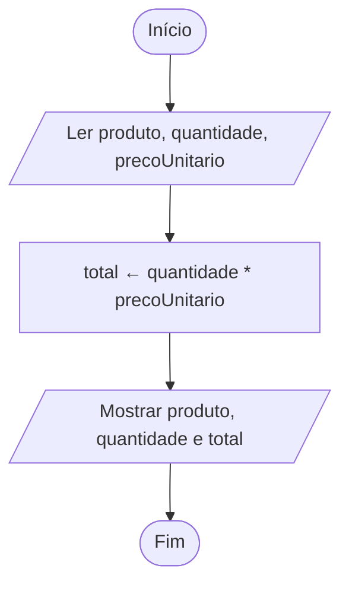

# Exercício 10 — Valor da compra

**1. Entradas:** nome do produto, quantidade comprada e preço unitário.

**2. Processamento:** total ← quantidade * precoUnitario.

**3. Saídas:** nome do produto, quantidade e valor total da compra.

**4. Pseudocódigo**

```
algoritmo "ValorDaCompra"
var
   produto: caractere
   quantidade: inteiro
   precoUnitario, total: real
inicio
   escreva("Digite o nome do produto: ")
   leia(produto)
   escreva("Digite a quantidade comprada: ")
   leia(quantidade)
   escreva("Digite o preço unitário: ")
   leia(precoUnitario)
   total <- quantidade * precoUnitario
   escreval("Produto: ", produto)
   escreval("Quantidade: ", quantidade)
   escreval("Valor total da compra: R$ ", total:0:2)
fimalgoritmo
```

**5. Fluxograma**


